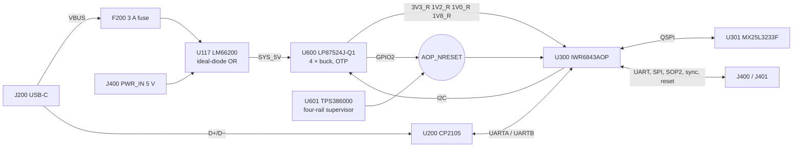
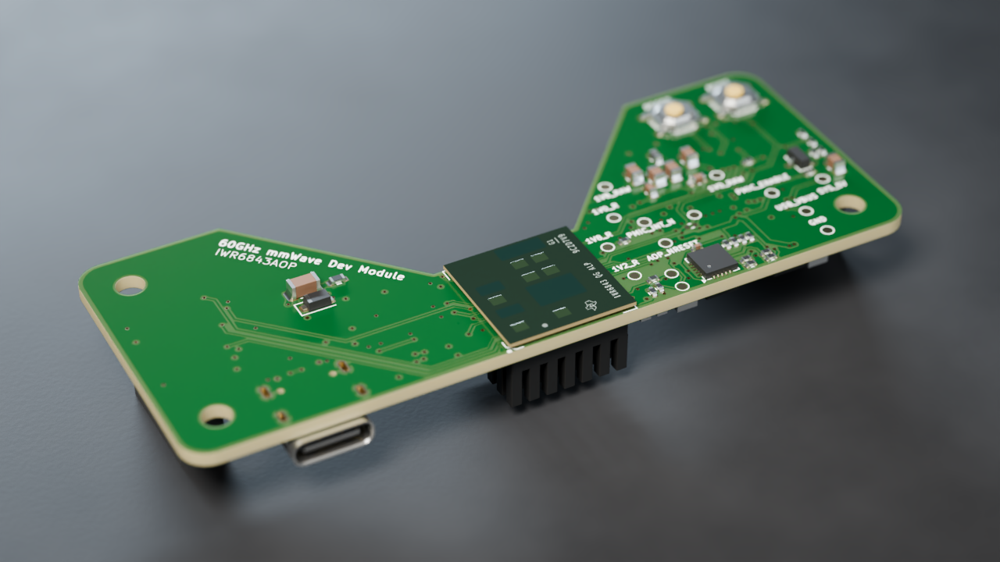
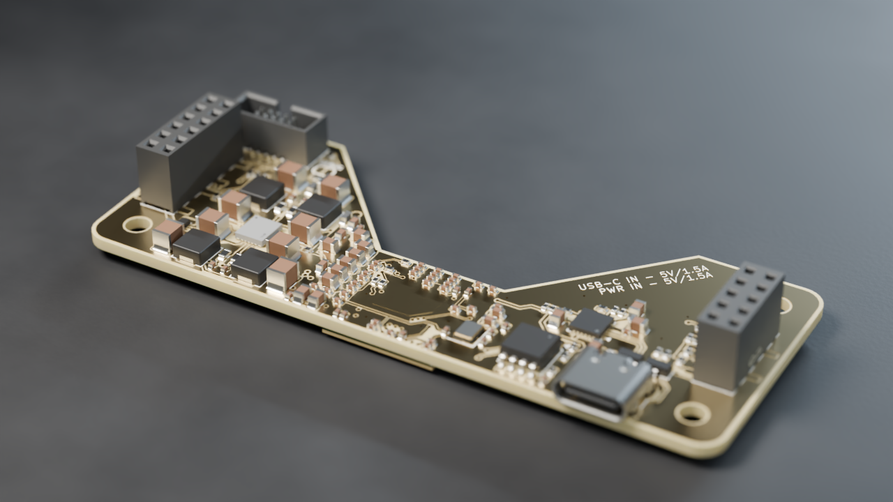

# STG-HW-SPEC-004 — IWR-AOP-MODULE design specification

**Document:** STG-HW-SPEC-004 · **Version:** 1.1 · **Date:** 15 November 2026 · **Board revision:** 1.1 (designed and simulated, not yet built)

This is the design reference for the module: how it works, how to connect to it, how it's built, and what still has to be measured on the first assembled boards. The board has not been built yet; the simulations behind the design are in [`simulation/`](../simulation/README.md). The [README](../README.md) is the short overview.

All coordinates are KiCad board millimetres, viewed from the top. Parts on the bottom (`B.Cu`) are given at the position a top-view observer sees; the frame is not mirrored.

---

## 1. Architecture

| Block | Parts |
|---|---|
| Radar | `U300` IWR6843ARQGALPR (60–64 GHz, 3 TX / 4 RX antenna-on-package), `Y300` 40 MHz crystal, `U301` MX25L3233F 32 Mbit QSPI boot flash |
| Power input | `J200` USB-C (GCT USB4105-GF-A), `F200` 3 A fuse, `D201` CC ESD, `C204`/`R210` hot-plug damper, `D202` SMF5.0A TVS; `J400.11/.12` carrier 5 V; `U117` LM66200 dual ideal diode |
| Rails | `U600` LP87524J-Q1 four-phase buck PMIC (OTP-configured); ferrites `FB600` + `FB602` (parallel) on 1.0 V and `FB601` on 1.8 V (BLM18KG260TN1D); 22 µF bulk behind the ferrites (`C624`, `C630`, `C633` on 1.0 V, `C625` on 1.8 V) and at the buck outputs (`C626`, `C628`); remote-sense networks `R628`/`C631` and `R629`/`C632` |
| Supervisor | `U601` TPS386000 on all four rails with dividers `R620`–`R627`; drives `AOP_NRESET` |
| PMIC I²C | Radar I²C (balls G3/G1) to the PMIC through `R605`/`R606` 0 Ω, pull-ups `R600`/`R601` to `3V3_R` |
| USB UART | `U200` CP2105 dual UART bridge, `D200` D+/D− ESD |
| Control | `SW400` RESET, `SW401` BOOT, `Q402` carrier disable, `R604`/`C605` reset options (both unfitted), `R417` carrier reset series resistor |
| Debug | `J301` Cortex-10 JTAG (2×5, 1.27 mm), `JP300` debug-mode solder jumper |
| Carrier | `J400` 2×6 and `J401` 2×5 HCTL PM254 2.54 mm SMD sockets on the back |
| Cooling | `HS300` 14 × 14 × 6 mm heat sink bonded to the back under the radar (fitted by hand, §6) |
| Test | `TP602`–`TP615` 1 mm pads on the front (rails, enable, reset, interrupt, PGOOD, I²C, GND) |

The board carries 164 assembled parts (35 front, 129 back) on 46 BOM lines, plus two do-not-populate parts (`R604`, `C605`), the solder jumper `JP300`, three M3 holes, the die thermal pad `TH300`, the heat sink `HS300` and fourteen test pads.

## 2. Operating modes

The module runs in one of two modes, set by what is plugged in. Both sources pass through `U117`, so an accidental double attach cannot back-feed either supply, but the shared radar UART is not arbitrated.

| Mode | Power | UART | SPI / boot / reset / disable |
|---|---|---|---|
| **USB-only** (no carrier) | USB-C default 5 V, ≥ 1.5 A source | CP2105: ECI = radar control/flash, SCI = telemetry in | Local BOOT/RESET buttons |
| **Carrier-only** (USB unplugged) | `J400.11/.12` `PWR_IN`, regulated 5 V | Carrier on `J400.1/.2` and `J401.9` | Carrier on `J401` and `J400.3/.5–.8` |
| USB and carrier together | Not supported. Power is protected; UART RX contends (carrier wins: `R209` 100 Ω against `R208` 1 kΩ) | — | — |
| 3.3 V on `PWR_IN` | Not supported: Buck0 cannot regulate 3.3 V, so the supervisor never releases reset | — | — |

## 3. Power

### 3.1 Input

- **USB-C sink.** `R100`/`R101` 5.1 kΩ 1 % Rd on CC1/CC2: the source supplies default USB power (vSafe5V) with no PD negotiation. Use a USB-C source advertising ≥ 1.5 A. USB-A-to-C cables and 500/900 mA ports are not supported and may brown out during chirps.
- **Source OR.** `U117` LM66200: VIN1 = `USB_VBUS` (after `F200`), VIN2 = `PWR_IN`, VOUT = `SYS_5V`, ON tied low (always enabled). The higher input supplies the output; 2.5 A per channel; controlled output slew at power-up. `C100` 1 µF on `USB_VBUS`, `C140` 10 µF on `PWR_IN`.
- **Hot plug.** A live USB-C source and a cable form a resonant circuit with the input ceramics. `C204` 10 µF in series with `R210` 0.47 Ω damps it and `D202` (SMF5.0A) clamps what is left. Simulated peaks on `USB_VBUS` are 5.0–5.5 V for 0.3–2 m cables and 5.0–5.5 V sources, against 7.9–8.9 V for the same input without them and the 6 V absolute maximum of `U117`.
- **Why 5 V only.** Buck0 makes 3.3 V and needs ≥ 0.5 V headroom (LP87524J-Q1 datasheet). From a 3.3 V input it stays under the supervisor threshold and `AOP_NRESET` never releases.
- **Budget (design estimate, not measured).** About 1.2–1.3 A peak and 0.3–0.45 A average at 5 V, dominated by radar chirps with three transmitters. Size any 5 V supply for ≥ 1.5 A. No power is exported on any connector.

### 3.2 Rails

`U600` LP87524J-Q1 runs from `SYS_5V` (`VIN_Bx`, `VANA`, `NRST`) at 4 MHz with 0.47 µH inductors (`L600`–`L603`). Its OTP sets every output, so the board starts with no I²C traffic. The radar can reach the PMIC over I²C once it runs (§8).

| Buck | Rail | Loads | Start-up (OTP) |
|---|---|---|---|
| Buck3 | `1V8_RAW` → `FB601` → `1V8_R` | Radar analog, clock, LVDS supply | 0 ms |
| Buck2 | `1V0_RAW` → `FB600` ‖ `FB602` → `1V0_R` | Radar RF and PA supply (internal LDOs bypassed) | 2 ms |
| Buck0 | `3V3_R` | Radar I/O, QSPI flash, pull-ups (≈ 70 mA max) | 5 ms |
| Buck1 | `1V2_R` | Radar digital core and SRAM | 5 ms |

The OTP order brings 1.8 V up before 3.3 V, as the IWR6843AOP requires (errata MSS#38A).

**Filter.** The ferrites are BLM18KG260TN1D (26 Ω at 100 MHz, 6 A, 7 mΩ maximum). TI's IWR6843AOPEVM uses a 120 Ω part in the same position; the 26 Ω part has about a quarter of the inductance, which still meets the radar's 4 MHz ripple limit with margin and roughly halves the dip a fast chirp current edge causes at the radar. The 1.0 V rail has two in parallel (`FB600` on the back, `FB602` on the front, at the same position), each carrying 1.25 A of the 2.5 A peak. Behind them sit `C624`, `C630` and `C633` (3 × 22 µF) on 1.0 V and `C625` (22 µF) on 1.8 V. Total nominal output capacitance is 137 µF on Buck2 and 88 µF on Buck3. The LP87524 datasheet names 100 µF for a single-phase output; TI's own EVM runs Buck2 with 174 µF, the loop model is stable with 137 µF, and the soft-start charging current is 0.52 A against a 5 A limit.

**Copper.** `1V0_R` runs on copper areas on `In3.Cu` and `F.Cu`, and `1V8_R` on a copper area on `In3.Cu` under the radar. Extracted from the routed board at 85 °C copper, the path from the ferrite outputs to the radar balls is 12.4 mΩ on 1.0 V and 13.7 mΩ on 1.8 V.

**Remote sense.** Regulating at the buck output, as the TI EVM does, would leave the radar about 36 mV low on 1.0 V at peak current. Regulating directly behind the ferrite would put the ferrite and its capacitors inside the loop. The feedback is therefore split by frequency:

| Rail | DC path (radar end) | AC path (buck output) | Crossover |
|---|---|---|---|
| 1.0 V | `R628` 22 Ω from `1V0_R` near the radar balls to `FB_B2` | `C631` 1 µF from `1V0_RAW` to `FB_B2` | 7 kHz |
| 1.8 V | `R629` 22 Ω from `1V8_R` at `TP606` to `FB_B3` | `C632` 1 µF from `1V8_RAW` to `FB_B3` | 7 kHz |

Below the crossover the PMIC regulates the voltage at the radar; above it the loop sees only its own output capacitors, as TI characterised it. Phase margin in the model is 71° or more across ferrite inductance from 10 to 130 % and capacitor spread. The network can be turned into the TI EVM arrangement by removing `R628`/`R629` and fitting 0 Ω in place of `C631`/`C632`.

**Voltage at the radar balls** (extracted copper at 85 °C, peak current, PMIC DC accuracy at its worst, ground return included):

| Rail | Peak current | Worst-case at the balls | Radar minimum | Margin |
|---|---|---|---|---|
| `1V0_R` | 2.5 A | 0.964 V | 0.95 V | +14 mV |
| `1V8_R` | 0.85 A | 1.752 V | 1.71 V | +42 mV |
| `1V2_R` | 1.0 A | 1.155 V | 1.14 V | +15 mV |
| `3V3_R` | 0.07 A | 3.229 V | 3.135 V | +94 mV |

The 2 % PMIC accuracy is the largest term on every rail. The current is assumed to split equally between the balls of a rail.

**Chirp load steps** (model, `simulation/run_loadstep.py`). The radar-side capacitors supply a current step until the ferrite current and the regulator catch up.

| Step at the radar | Edge | 1.0 V minimum | 1.8 V minimum |
|---|---|---|---|
| Idle to full peak (0.1 → 2.5 A, 0.1 → 0.85 A) | 100 µs | 0.989 V | 1.796 V |
| Idle to full peak | 10 µs | 0.923–0.942 V | 1.764–1.779 V |
| Idle to full peak | 1 µs | 0.911–0.935 V | 1.750–1.775 V |
| Two transmitters (0.5 → 2.0 A) | 10 µs | 0.959 V | n/a |

The ranges cover ferrite inductance from 100 % down to 10 % of its small-signal value. The 1.8 V rail stays inside its limits in every case. The 1.0 V rail stays inside 0.95–1.05 V for two-transmitter steps and for any edge of 100 µs or slower; a full three-transmitter step with an edge of 10 µs or faster dips to 0.91–0.94 V for about 6 µs. With a 10 µs edge and half the ferrite inductance the figure is 0.934 V; the filter of the TI EVM gives 0.875 V under the same conditions. The buck output never comes near the supervisor threshold, so a dip cannot reset the radar. Firmware can add headroom by raising Buck2 by a few 5 mV steps over I²C (§8).

### 3.3 Enable and reset

- **Enable.** `R133` pulls `PMIC_ENABLE` (EN1, all four bucks) up to `SYS_5V`. The carrier's `HOST_DISABLE` (`J400.7`, active high, `R414` default low) turns on `Q402`, which pulls EN1 low and removes every radar rail including `3V3_R`. `SYS_5V` stays up.
- **Reset.** `AOP_NRESET` is pulled up to `3V3_R` by `R603` 10 kΩ. Its open-drain sinks are:
  - **`U601` TPS386000 supervisor.** It runs from `SYS_5V` and watches all four rails through 1 % dividers, with its four reset outputs tied together on `AOP_NRESET`:

    | Rail watched | Divider | Falling threshold | Radar minimum |
    |---|---|---|---|
    | `3V3_R` | `R620`/`R621` | 3.067 V | 3.135 V |
    | `1V8_RAW` | `R622`/`R623` | 1.653 V | 1.71 V |
    | `1V2_R` | `R624`/`R625` | 1.120 V | 1.14 V |
    | `1V0_RAW` | `R626`/`R627` | 0.900 V | 0.95 V |

    The thresholds sit just under the radar minimums so that tolerance and load-step dips cannot cause nuisance resets, and the worst-case release voltage of each channel is still below the rail's regulation band. The 1.0 V and 1.8 V channels watch the buck outputs, ahead of the ferrites. With the `CT` pins open the release delay is 20 ms; `MR` is tied to `SYS_5V`; the watchdog is unused. Simulated: reset releases 20 ms after the last rail settles, about 27 ms after EN1 rises. On a USB unplug it asserts 17 µs after `3V3_R` passes 3.13 V and about 230 µs before the first core rail leaves its range. A 1 ms dropout on 5 V never releases reset with a core rail down.
  - **PMIC GPIO2** (pin 15). The OTP makes it an open-drain output that follows EN1: low 0 ms after EN1 falls, released 5 ms after EN1 rises (SNVU663A Table 3-9). It asserts reset 12 µs after `HOST_DISABLE` is applied, before any rail decays.
  - `SW400`, `J301.10`, and the carrier on `J400.8` through `R417` 1 kΩ (net `HOST_NRESET`).
  - **PMIC PGOOD is not a reset source.** `R604` is not fitted, and `PMIC_PGOOD` is available on `TP613`. Its window (−29 to −53 mV) is the same size as a chirp load step, so it would reset the radar during frames. Fitting `R604` 0 Ω adds it as a reset source. `C605` stays unfitted; a capacitor there would only slow the reset edges.
  - A protection shutdown (thermal, overvoltage, short circuit) turns the rails off and the supervisor holds reset. Removing 5 V recovers; cycling `HOST_DISABLE` should too (it re-enables the bucks) but is unverified. While the radar runs, firmware can read and clear the PMIC's warning flags over I²C (§8).

## 4. Radar, boot and UART

### 4.1 UART paths

| Signal | Radar ball | Connected to |
|---|---|---|
| `AOP_UART_TX` (UARTA TX) | U16 | CP2105 `RXD_ECI`, `J400.1` |
| `AOP_UART_RX` (UARTA RX) | V16, via `R314` 0 Ω | CP2105 `TXD_ECI` through `R208` 1 kΩ; carrier `J400.2` through `R209` 100 Ω; `R416` 10 kΩ pull-up to `3V3_R` |
| `AOP_DATA_TX` (UARTB TX) | E2 | CP2105 `RXD_SCI`, `J401.9` |

- `R208` limits current from the CP2105 (powered from USB at 3.45 V) into the radar while the PMIC is still starting, and lets a carrier override it.
- In carrier-only mode the CP2105 is unpowered. Its UART pins tolerate VIO + 3.6 V unpowered (CP2105 datasheet, Table 1), so radar traffic does not back-power it.
- Removing `R314` isolates the radar RX ball (V16) from the CP2105 and the carrier, for rework or an external UART.

### 4.2 Boot

| Mode | SOP2/SOP1/SOP0 | How |
|---|---|---|
| Normal (QSPI flash) | 0/0/1 | BOOT released, then reset |
| UART flashing (SOP5) | 1/0/1 | USB-only: hold RESET, hold BOOT, release RESET, release BOOT; flash over the CP2105 ECI port. Carrier-only: the carrier drives `J400.5` `AOP_SOP2` |
| JTAG debug | 0/1/1 | BOOT released; bridge `JP300` (SOP1 high), then reset. Clear `JP300` to return to normal boot |

`SW401` drives `AOP_SOP2` through `R410` 1 kΩ. Don't press BOOT while a carrier is driving `SOP2`. Change straps only while reset is held.

The MX25L3233F ships with its QE bit cleared. Flashing must set the non-volatile QE bit (status register bit 6) before the radar can boot in quad mode; wait for WIP = 0 before any reset (errata MSS#45). The part is on TI's list of compatible flash (SPRACH9G).

### 4.3 Debug header and jumper (back)

`J301` is a standard ARM Cortex 10-pin (1.27 mm, 2×5, shrouded) JTAG header on the back, wired for the Black Magic Probe or TI XDS110. It shares the back with the carrier sockets, so it is for development off a carrier (USB power + JTAG); an integrated module on a carrier doesn't use it. The 5.6 mm header body sits under the 8.5 mm socket mating height, so the carrier needs a clear area beneath it.

| Pin | `J301` | Pin | `J301` |
|---|---|---|---|
| 1 | VTref (`3V3_R`) | 2 | TMS (U8) |
| 3 | GND | 4 | TCK (T3) |
| 5 | GND | 6 | TDO (U10, shared with SOP0) |
| 7 | key, no connection | 8 | TDI (U9) |
| 9 | GND | 10 | `AOP_NRESET` |

- The header supplies no power. Keep the probe's target power off (Black Magic Probe: `monitor tpwr disable`, the default); pin 1 is the radar's 3.3 V rail. Never drive a pin while `3V3_R` is off. Start JTAG at 1 MHz.
- The radar's R4F sits behind TI's ICEPick JTAG router. Black Magic Debug v2.1.0 supports ICEPick on AM335x and TMS570; this part is not on its list, so confirm the attach on the first board (TI XDS110 is the known-good fallback). JTAG does not program the QSPI flash; flash over UART (§4.2).
- JTAG attaches in normal boot (0/0/1) with the application running. For debug mode (0/1/1: bootloader bypassed, R4F halted) bridge `JP300`, a two-pad solder jumper (`SolderJumper-2_P1.3mm_Open`) from SOP1 to `3V3_R`. Change it unpowered or with reset held, and clear it for normal boot.

## 5. Carrier interface

Two HCTL PM254 SMD sockets on the back, 2.54 mm pitch, 8.5 mm nominal height, both rotated 180° with pin 1 toward the top edge and odd/even numbering across the rows. `J400` sits on the right edge (next to the PMIC), `J401` on the left; the split follows the radar's ball groups so no signal crosses the antenna gap.

| Pin | `J400` PM254-2-06-S-8.5 (C3975151): UART / control / power | `J401` PM254-2-05-S-8.5 (C3975150): SPI / data |
|---|---|---|
| 1 | `AOP_UART_TX` (out) | `HOST_SPI_CLK` (in) |
| 2 | `HOST_UART_TX` (in) | GND |
| 3 | `HOST_SYNC_IN` (in) | `HOST_SPI_MOSI` (in) |
| 4 | GND | `AOP_SPI_MISO` (out) |
| 5 | `AOP_SOP2` (in, boot select) | `HOST_SPI_CS_N` (in) |
| 6 | `AOP_NERROR_OUT` (out, open-drain) | GND |
| 7 | `HOST_DISABLE` (in, active high) | `AOP_HOST_INTR` (out) |
| 8 | `HOST_NRESET` (open-drain, bidirectional; `AOP_NRESET` through `R417` 1 kΩ) | `FRAME_START` (out) |
| 9 | GND | `AOP_DATA_TX` (out) |
| 10 | GND | GND |
| 11 | `PWR_IN` 5 V | — |
| 12 | `PWR_IN` 5 V | — |

All logic is 3.3 V (`3V3_R`); none of it is 5 V tolerant. Carrier rules:

1. `PWR_IN`: one regulated 5 V supply, 4.5–5.5 V at the pins, on both contacts. Unplug USB.
2. Keep every carrier output and pull-up on a radar signal high-impedance while `3V3_R` is off: until `J400.8` first goes high, and whenever `HOST_DISABLE` is asserted. Release them before asserting `HOST_DISABLE`. `J400.8` goes low as soon as `HOST_DISABLE` is applied (§3.3).
3. Reset the radar by pulling `J400.8` low with an open-drain output. Never drive it high. High means all rails are good and reset is released. Through `R417` a carrier low reaches the radar as about 0.3 V (input low threshold 0.65 V).
4. Never drive `J400.2` while USB is attached.
5. `HOST_SYNC_IN` (frame trigger in), `FRAME_START` (hardware frame-start pulse out) and `AOP_NERROR_OUT` are optional; leave them open if the carrier firmware doesn't use them. A `SYNC_IN` pulse must be > 25 ns and < 4 µs (errata MSS#44A).
6. SPI is the radar's SPIA in peripheral mode (pinmux 1); the protocol is defined by the radar firmware.

**Keying.** A centred 2×5 header can seat on the middle of the 2×6 socket, so the different lengths don't stop a 180° reversal. Offset the headers on the carrier or block a hole.

## 6. Mechanical

The renders show the board as assembled, with the heat sink `HS300` bonded to the back.

| Item | Value |
|---|---|
| Outline | 85.6 × 33.7 mm, 3.18 mm corner radii, x 106.279–191.879, y 94.546–128.246 |
| Top-edge notch | Open trapezoid (123.484, 94.546) → (140.479, 112.846) → (157.679, 112.846) → (174.674, 94.546): 17.2 mm wide at the bottom, 51.19 mm at the edge, 18.3 mm deep |
| Radar `U300` | (149.079, 120.546), 90°, front. 15 × 15 mm package |
| Antenna (E-plane) gaps | The bottom board edge and the bottom of the notch are each 0.20 mm from the package, inside TI's < 0.3 mm requirement (SWRZ092B PACKAGE#02) |
| Mounting holes | Three 3.2 mm NPTH for M3: `H1` (111.254, 99.521), `H4` (111.254, 123.271), `H3` (186.904, 123.271); ≈ 5 mm from the adjacent edges. No hole at the top right |
| Carrier sockets | `J401` (111.254, 111.396), `J400` (186.904, 111.396): back, 180°, on the hole columns, centred vertically; 75.65 mm apart |
| Debug header and jumper | `J301` (182.235, 99.000), back; `JP300` (173.625, 101.050), back |
| USB-C | `J200` (121.230, 125.359), back, opening at the bottom edge |
| Mating height | Socket designation and model say 8.5 mm. Not measured: confirm with purchased sockets and headers before fixing carrier standoffs |

**Keep-outs.** `U300` carries two named all-copper keep-outs (`IWR6843AOP_EPlane_Column1`, `IWR6843AOP_EPlane_Column18`) on all six layers. Keep carrier metal, cables and enclosure walls out of the antenna aperture; the antenna faces broadside from the front.

**Heat sink.** `HS300` is a 14 × 14 × 6 mm aluminium pin-fin BGA heat sink (Same Sky HSB03-141406 or Fischer ICK BGA 14 × 14 × 6) on the back, centred under the radar at (149.079, 120.546). TI's thermal guide for this package (SWRA672) puts the heat sink on the back because the front is the antenna. It is bonded by hand after assembly with a thermally conductive silicone adhesive. Everything under its outline is an 0402 part (0.55 mm tall), which sets the bond line; the adhesive fills around the parts and insulates them. The outline is on `B.Fab`. With the 8.5 mm sockets there is at least 1.5 mm between the heat sink and a carrier, so a carrier needs no cut-out. Without it the module still works at low duty (§10). In USB-only use, with nothing under the board, a taller heat sink of the same footprint lowers the temperature further.

**Front-side parts and the antenna.** The supervisor, the sense network and some bulk capacitors are on the front, the side the antenna faces. All are outside the E-plane keep-outs, and none rises more than 4° above the plane of the package top as seen from the package edge (the tallest are 0805 and 1206 capacitors 11 mm or more away), so they stay outside the antenna's field of view.

**Die thermal pad.** The radar die sits in the ball-free centre of the package (SWRS237C p.84). Board-only `TH300` places a GND pad under it on both faces: same outline, mask open, no paste. The `AOP_backside_thermal_reserve` rule area keeps components off that outline on the back; copper and vias are allowed.

## 7. PCB and fabrication

### 7.1 Stack

| Layer | KiCad | Role |
|---|---|---|
| L1 | `F.Cu` | Signals, local power, GND pour |
| L2 | `In1.Cu` | GND plane |
| L3 | `In2.Cu` | Signals (referenced to L2) |
| L4 | `In3.Cu` | Power partitions |
| L5 | `In4.Cu` | GND plane |
| L6 | `B.Cu` | Signals, local power, GND pour |

1.6 mm FR-4, ENIG. The board file carries a nominal stack (dielectrics 0.10 / 0.10 / 1.04 / 0.10 / 0.10 mm) that keeps L3 next to GND and away from the split L4. No trace is impedance-controlled (USB is full speed through the CP2105), so any JLC 6-layer 1.6 mm stack is usable. Prefer one where L3 is closer to L2 than to L4; JLC06161H-3313 is the opposite (L3 0.109 mm from L4, 0.55 mm from L2).

### 7.2 Vias and rules

- **Every via is epoxy filled and copper capped** (IPC-4761 Type VII; JLC's free POFV on 6–20 layers). This is what allows via-in-pad at `U300`, `U600` and the radar passives. The board's via flags say the same (filling yes, capping yes). Don't accept ink plugging.
- Vias (244): 234 × 0.45/0.30 mm, 6 × 0.60/0.30 mm, 3 × 0.40/0.25 mm (under `U300`), 1 × 0.35/0.20 mm (the 1.0 V sense tap inside `R628` pad 1). Minimum track 0.15 mm in general and 0.10 mm for the I²C escape from ball G1. All of this is inside JLCPCB's published 6-layer capability (0.09 mm track and space, 0.15 mm via hole, 0.2 mm copper to a routed edge).
- Custom rules (`IWR-AOP-MODULE.kicad_dru`): 0.09 mm trace/space and 0.15 mm hole clearance inside the `U300` escape; 0.10 mm to `U300` pads; via 0.35 mm minimum, drilled hole 0.20–0.50 mm (the fill process window); same-net via-in-pad allowed; 0.2 mm edge clearance only inside the E-plane keep-outs; 0.3 mm edge clearance for `AOP_I2C_SDA`, which leaves the outer ball row along the board edge under the package; the USB-C receptacle's own shell-post geometry.

### 7.3 Accepted check results

Checked with KiCad 10.0.8. ERC: 0 errors and 7 `same_local_global_label` warnings (a local label that repeats the name of a global one on the same net). DRC with schematic parity: 0 unconnected, 0 parity, and these accepted findings:

| Finding | Count | Why accepted |
|---|---|---|
| `hole_clearance` error at `U600` and `U601` | 8 | Filled, capped vias in pads under no-net paste apertures: seven in the PMIC's pads and the GND via in the `U601` exposed pad; covered by the via process |
| `silk_over_copper` warning | 32 | Silkscreen clipped by mask openings and vias (outlines of `J301`, `J400`, `U301`, `SW401` over vias); JLC clips silk on exposed copper |
| `text_height` warning | 12 | Test-pad net labels and the `JP300` "DEBUG" label at 0.7 mm |
| `lib_footprint_mismatch` warning | 1 | `U200` uses KiCad's 4 × 4 mm QFN-24 3D model in place of the library's |

### 7.4 Ordering

The JLCPCB package and its build script are in [`manufacturing/`](../manufacturing/README.md).

## 8. Firmware requirements

1. Before `MMWave_open()`, configure the external 1.0 V supply: `rlRfSetLdoBypassConfig()` with `ldoBypassEnable = 3` (RF LDO bypass and PA LDO disabled), `ioSupplyIndicator = 0` (3.3 V I/O), and set `supplyMonIrDrop` for this board. Three-transmitter operation needs this mode (SWRS237C). The internal RF/PA LDOs must never drive the external 1 V rail.
2. Set the flash's non-volatile QE bit when programming; wait for WIP = 0 before reset (§4.2).
3. Pinmux: UARTA RX V16 mode 2, TX U16 mode 5; UARTB TX E2 mode 6; SPIA D2/C2/F2/D1 mode 1; `FRAME_START` K3 mode 13; `SYNC_IN` U12 mode 1. Keep LVDS disabled.
4. `VBGAP` (A16) has 47 nF; the reference outputs on A9/A10 are decoupled only.
5. Carrier firmware: follow the rules in §5 (Hi-Z while `3V3_R` is off, open-drain reset only).
6. PMIC I²C: pinmux G3 (`I2C_SCL`) and G1 (`I2C_SDA`) to mode 2; the LP87524 answers at address 0x60. The pull-ups are on the board. The board needs no I²C writes to run. The bus gives per-buck current readback, the thermal warning and the interrupt flags, and lets firmware trim a rail: Buck2 in 5 mV steps if measured chirp dips call for more headroom on 1.0 V (§3.2).
7. The reset releases about 27 ms after the 5 V input is valid (§3.3).

## 9. Bring-up checks

The simulations in [`simulation/`](../simulation/README.md) cover what can be computed from the layout and the datasheets. These are the measurements for the first assembled boards:

1. **Assembly.** Check every part in JLC's placement preview, especially `U300` (BGA), `U600`, `U601`, `U117`, `U200`, `U301`, `D200`/`D201`/`D202` and the sockets. Bond `HS300` after the board has passed its electrical checks.
2. **Rails.** At the test pads, check `SYS_5V`, `1V8_R`, `1V0_R`, `3V3_R` and `1V2_R` and the start-up order. `TP608`/`TP609` give the buck outputs `1V0_RAW`/`1V8_RAW`; under load they sit above the radar-side pads by the ferrite and copper drop (about 36 mV on 1.0 V at 2.5 A).
3. **USB-C start-up** on 1.5 A and 3 A sources: hot-plug peak on `TP610`, inrush, droop at chirp peaks, cable drop.
4. **Reset.**
   - `AOP_NRESET` (`TP603`) releases about 20 ms after the last rail settles and re-asserts when a rail is pulled under its threshold.
   - With `HOST_DISABLE` applied, `TP603` falls before `1V2_R` and `1V0_R` leave their ranges (GPIO2).
   - Run three transmitters at the maximum-duty chirp profile, hot and cold, with the scope triggered on `TP603` falling: no resets during frames.
   - Boot from flash and in UART flashing mode.
5. **Chirp load step.** `TP605` (`1V0_R`) and `TP606` (`1V8_R`) AC-coupled during three-transmitter chirps, compared with the table in §3.2.
6. **Back-power.** No `3V3_R` lift or latch-up from the CP2105 driving through `R208` while the PMIC starts.
7. **Rail quality.** `1V0_R`/`1V8_R` switching ripple during chirps against SWRS237C Table 7-2, and no ringing after a load step on `TP608`/`TP609`.
8. **Temperature.** Radar junction temperature from the on-chip sensor at the intended duty cycle, in the intended mounting, compared with §10.
9. **Current.** Input current per mode, peak and inrush. Don't publish a rating from datasheet values alone.
10. **I²C.** Radar firmware reads the PMIC device ID (`TP614`/`TP615`).
11. **Carrier fit.** Socket height, header fit, heat sink clearance, standoffs and keying with purchased parts.

## 10. Limits

- No USB PD; default USB power only.
- USB and carrier together, 3.3 V on `PWR_IN`, or driving `J400.8` high are outside the design.
- **Temperature.** First-order model of the board in still air, with no carrier or housing around it (`simulation/thermal_board.py`). Maximum ambient keeps the radar junction at or under 105 °C:

  | Radar power | Junction rise with `HS300` | Maximum ambient with `HS300` | Maximum ambient without |
  |---|---|---|---|
  | 0.6 W (idle or low duty) | 17 K | 88 °C | 81 °C |
  | 1.25 W (two transmitters, 24 % duty) | 34 K | 71 °C | 58 °C |
  | 1.75 W (two transmitters, 48 % duty) | 48 K | 58 °C | 41 °C |
  | 2.3 W (three transmitters, high duty; estimate) | 62 K | 43 °C | 21 °C |

  The heat sink figure used is the less favourable of the two named parts (39.7 K/W in natural convection). Airflow, or a housing wall against the heat sink, lowers the rise further; a sealed housing with no heat path raises it.
- **Fast three-transmitter chirp edges.** A full 0.1 → 2.5 A step on 1.0 V with an edge of 10 µs or faster dips to 0.91–0.94 V for about 6 µs in the model (§3.2). Two-transmitter operation and slower edges stay inside the limits. TI does not publish the edge rate of the radar's supply current.
- **Model limits.** The LP87524 control loop is internal and undocumented; the model is calibrated to TI's datasheet load-step test. The FB pin input resistance is taken as 100 kΩ or more (22 Ω in series then costs under 0.3 mV). Ferrite inductance under DC bias is swept, not known. The antenna pattern has not been simulated; the layout follows TI's keep-out and edge-gap rules.
- **Nothing is measured yet.** Every figure in this document is from datasheets, layout extraction or simulation.
- Supply limit: `U301` MX25L3233F (C190802) is an extended part with thin JLC stock (38 on 2 October 2026, 3 on 5 October 2026). Check stock before each assembly order.

## 11. Sources

Datasheets used by this design are in [`references/datasheets/`](../references/datasheets/).

| Topic | Source |
|---|---|
| Radar pinout, supplies, rail currents, reset timing, die location, 3-TX LDO bypass | TI IWR6843AOP datasheet SWRS237C |
| E-plane gap (PACKAGE#02), errata MSS#38A/#41/#44A/#45, ANA#16/#18B/#19 | [TI SWRZ092B](https://www.ti.com/lit/er/swrz092b/swrz092b.pdf) |
| Heat sink on the back, thermal pad practice under the die | [TI SWRA672](https://www.ti.com/lit/an/swra672/swra672.pdf) |
| Supervisor thresholds, delay, `MR` and `CT` behaviour | TI TPS386000 datasheet |
| Reference power filter (ferrite part, capacitor values, sense point) | TI IWR6843AOPEVM schematic |
| Ferrite equivalent circuits | Murata BLM18KG260TN1 and BLM18KG121TH1 SPICE models |
| Supervisor land pattern | TI TPS386000 datasheet, RGP mechanical data (2.15 mm thermal pad) |
| Heat sink | [Same Sky HSB03-141406](https://sameskydevices.com/product/thermal-management/heat-sinks/bga-heat-sinks/hsb03-141406) · Fischer Elektronik ICK BGA 14 × 14 × 6 |
| PMIC headroom, PGOOD window, delay and masking (Table 6), load step, output-capacitance limit, EN rating | TI LP87524J-Q1 datasheet SNVSAW2B |
| PMIC OTP start-up order, GPIO2 and PGOOD configuration | TI SNVU663A, Tables 3-8, 3-9 and 3-10 |
| Source OR behaviour | TI LM66200 datasheet |
| CP2105 unpowered pin rating | [Silicon Labs CP2105 datasheet](https://www.silabs.com/documents/public/data-sheets/CP2105.pdf), Table 1 |
| Flash compatibility | TI SPRACH9G; Macronix MX25L3233F datasheet |
| Carrier sockets | [HCTL PM254-2-06-S-8.5](https://wmsc.lcsc.com/wmsc/upload/file/pdf/v2/lcsc/2306091018_HCTL-PM254-2-06-S-8-5_C3975151.pdf) · [PM254-2-05-S-8.5](https://wmsc.lcsc.com/wmsc/upload/file/pdf/v2/lcsc/2306091018_HCTL-PM254-2-05-S-8-5_C3975150.pdf) |
| Via-in-pad process | [JLCPCB free POFV on 6–20 layers](https://jlcpcb.com/news/free-via-in-pad-6-20-layer-pcbs-pofv) · [JLCPCB BGA guidelines](https://jlcpcb.com/help/article/bga-design-guidelines---pcb-layout-recommendations-for-bga-packages) · IPC-4761 |
| JLC 6-layer stacks | <https://jlcpcb.com/impedance> |
